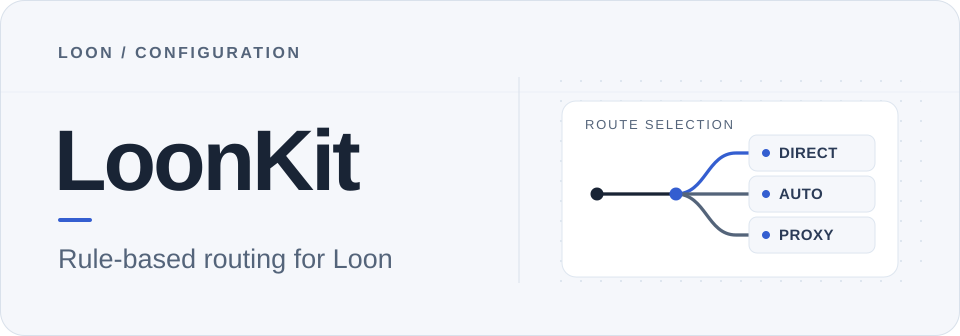

  <picture>
    <source media="(max-width: 600px) and (prefers-color-scheme: dark)" srcset="./docs/assets/readme-hero-mobile-dark.svg" />
    <source media="(max-width: 600px)" srcset="./docs/assets/readme-hero-mobile-light.svg" />
    <source media="(prefers-color-scheme: dark)" srcset="./docs/assets/readme-hero-wide-dark.svg" />
    
  </picture>

  <strong>适用于 Loon 的规则分流配置与网络辅助工具。</strong>

  国内常用服务优先直连，AI、开发平台、流媒体与社交应用可分别选路； 
  配合节点管理、广告过滤和连接诊断，按需要调整每一类流量的去向。

  <a href="https://www.nsloon.com/openloon/import?sub=https%3A%2F%2Fraw.githubusercontent.com%2FYohakuSama%2Floonkit%2Fmain%2FLoonKit.lcf">
    <picture>
      <source media="(prefers-color-scheme: dark)" srcset="./docs/assets/readme-cta-dark.svg" />
      
    </picture>
  </a>

  <a href="https://raw.githubusercontent.com/YohakuSama/loonkit/main/LoonKit.lcf">获取配置地址</a> ·
  <a href="#快速开始">快速开始</a> ·
  <a href="./docs/SETUP_GUIDE.md">配置指南</a>

  <a href="./docs/CHANGELOG.md">Release notes</a> · <a href="https://github.com/YohakuSama/loonkit/actions/workflows/ci.yml">Production CI</a> · <a href="./LICENSE">GPL-2.0-only</a>

当前版本：**v7.0.9**。

> [!NOTE]
> 项目不提供节点、订阅或代理账号。使用前请准备好 Loon 和自己的节点，并备份已有配置。

---

## 功能概览

**按服务分流**  
国内常用服务优先直连，AI、Google、GitHub、流媒体及社交服务使用对应策略组。可以在 Loon 中为不同服务分别指定线路，而不必让全部流量共用同一个出口。

**灵活选择节点**  
在 `Proxy` 中手动选择线路，或使用 `Auto` 根据测速结果选路、`Fallback` 在候选线路中选择可用节点。`AdBlock` 可按需求选择拦截、直连或代理。

**定位网络问题**  
在选定节点上查看出口信息、连接状态与 DNS 结果。网络辅助提供的是测试时的参考信息，不替代 Loon 的请求日志，也不保证节点始终可用。

## 快速开始

1. **备份**：首次导入前，先导出现有配置并保存节点订阅。
2. **导入**：在 iPhone / iPad 的 Safari 中点击顶部「一键导入 Loon」；若未唤起 App，可在 **配置 → 所有配置文件 → ＋ → 从链接导入** 中粘贴[配置地址](https://raw.githubusercontent.com/YohakuSama/loonkit/main/LoonKit.lcf)。
3. **配置线路**：应用 `LoonKit.lcf`，再添加自己的节点或订阅，在 `Proxy` 与各服务策略组中选路。
4. **更新**：需要托管更新时可开启「托管」并设置频率；日常更新建议关闭「全覆盖更新」。

> [!IMPORTANT]
> 主配置的 `[Proxy]` 和 `[Remote Proxy]` 默认不包含个人节点。**「全覆盖更新」可能替换现有节点、订阅及本地设置。** 只有完成备份、确认接受覆盖后果时，才在首次完整部署中使用。

[详细导入步骤](./docs/SETUP_GUIDE.md) · [托管与更新选项](./docs/LOON_APP_SETTINGS.md)

## 使用与排查

- **切换线路**：在 Loon 的策略页选择服务策略组，改选 `DIRECT`、`Proxy`、`Auto` 或 `Fallback`。其中 `Fallback` 选择第一个可用节点，而不是延迟第二低的节点。
- **检查出口**：在 **策略 → 选定节点 → ···** 中运行所需的网络辅助工具，区分节点入口、实际出口与连接状态。[网络辅助说明](./docs/NETWORK_DIAGNOSTICS.md)
- **核对 DNS**：可在 **DNS → DNS 服务器** 中检查「查询回落」选项。隐私优先时可以关闭，但 DoH 不可用时可能导致解析失败；该设置不代表设备不存在 DNS 泄漏。[DNS 设置与核验](./docs/DNS_PRIVACY.md)

<strong>进阶设置与兼容性</strong>

- 节点测速默认使用 `http://www.bing.com`，实际结果受网络与节点影响。
- 自动选路和备用线路的候选筛选可分别设置，见[节点选择说明](./docs/NODE_SELECTION.md)。
- 网络辅助使用脚本功能，无需仅为此安装 MitM 证书。
- TUN、UDP、QUIC、IPv6 应根据实际网络及节点协议调整；遇到问题时先核对 Loon 请求记录。

## 常见问题

<strong>点击导入后没有打开 Loon？</strong>

请确认设备已安装 Loon，并用 Safari 打开页面。也可以在「配置 → 所有配置文件 → ＋ → 从链接导入」中手动粘贴[配置地址](https://raw.githubusercontent.com/YohakuSama/loonkit/main/LoonKit.lcf)。参见 [Loon 官方 URL Scheme](https://nsloon.app/docs/Scheme/)。

<strong>导入后没有可用节点？</strong>

LoonKit 不内置个人节点。请添加自己的节点订阅，并检查 `Proxy` 及服务策略组的线路选择。若启用了全覆盖更新，还应确认原有设置是否被替换。

<strong>节点能连接，但诊断偶尔失败？</strong>

首次握手、DNS/TLS 连接、临时网络波动等因素都可能影响结果。建议在同一节点复测，并结合请求记录与脚本日志排查。如需提交 [Issue](https://github.com/YohakuSama/loonkit/issues)，请先移除节点密钥和私人订阅链接。

## 文档导航

**使用指南** · [导入与设置](./docs/SETUP_GUIDE.md) · [配置托管](./docs/LOON_APP_SETTINGS.md) · [节点选择](./docs/NODE_SELECTION.md) · [DNS 设置](./docs/DNS_PRIVACY.md)

**规则与诊断** · [规则分类](./rules/README.md) · [网络辅助](./docs/NETWORK_DIAGNOSTICS.md) · [插件源码](./release/v7.0.9/Network_Diagnostics.plugin)

**项目维护** · [更新日志](./docs/CHANGELOG.md) · [发布说明](./docs/RELEASE_NOTES_v7.0.9.md) · [版本校验](./docs/RELEASE_CHECKSUM_v7.0.9.md) · [维护指南](./docs/MAINTAINING.md)

[Issues](https://github.com/YohakuSama/loonkit/issues) · [Security](./SECURITY.md) · [Third-party notices](./docs/THIRD_PARTY_NOTICES.md) · [GPL-2.0-only](./LICENSE)
