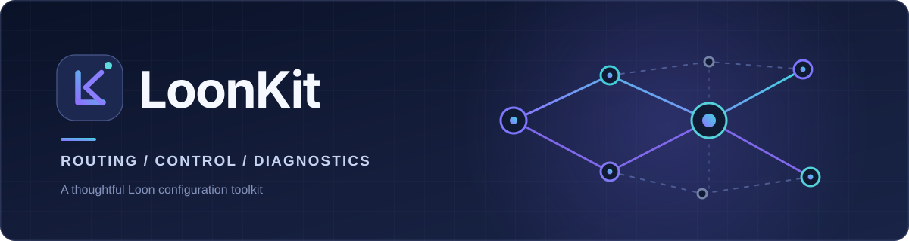

<p align="center">
  
</p>

<div align="center">

### 为 Loon 打造的分流配置与网络工具箱

**精细分流 · 自由选路 · 广告管理 · 网络诊断**

[](https://nsloon.app/)
[](./docs/CHANGELOG.md)
[](https://github.com/YohakuSama/loonkit/actions/workflows/ci.yml)
[](./LICENSE)

<a href="https://www.nsloon.com/openloon/import?sub=https%3A%2F%2Fraw.githubusercontent.com%2FYohakuSama%2Floonkit%2Fmain%2FLoonKit.lcf"></a>
<a href="https://raw.githubusercontent.com/YohakuSama/loonkit/main/LoonKit.lcf"></a>

**[快速开始](#-快速开始)** · **[功能亮点](#-功能亮点)** · **[策略组](#-常用策略组)** · **[使用文档](#-文档导航)** · **[问题反馈](https://github.com/YohakuSama/loonkit/issues)**

<sub>推荐使用 iPhone / iPad 的 Safari 打开本页并点击「一键导入 Loon」。</sub>

</div>

---

LoonKit 是一套面向 [Loon](https://nsloon.app/) 的配置方案，将常用网站、AI 服务、流媒体、社交平台的分流规则与网络诊断工具集中管理。**主配置不包含节点或机场订阅**，你可以自由接入已有订阅并按需选择线路。

## 🚀 快速开始

1. **导入配置**：点击顶部 **「一键导入 Loon」**，根据 Loon 提示完成远程配置导入。
2. **添加节点**：在 Loon 中添加自己的节点或节点订阅；在 `Proxy` 策略组中选择可用线路。
3. **刷新资源**：更新远程规则、插件与脚本，再根据网络环境调整分流策略。

> [!IMPORTANT]
> LoonKit **不提供代理节点、订阅服务或账号**。导入前建议备份原有配置；仅导入规则并不会自动获得可用代理线路。

<details>
<summary><b>无法通过按钮唤起 Loon？展开查看手动导入方法</b></summary>

在 Loon 中打开 **配置 → + → 从 URL 下载**，粘贴下面的正式版配置地址：

```text
https://raw.githubusercontent.com/YohakuSama/loonkit/main/LoonKit.lcf
```

也可以先 [下载 LoonKit.lcf](https://raw.githubusercontent.com/YohakuSama/loonkit/main/LoonKit.lcf)，再从本地文件导入。若在 GitHub 内置浏览器中无法唤起 Loon，请尝试用 Safari 打开本页。

</details>

## ✨ 功能亮点

| 模块 | 能做什么 |
| :--- | :--- |
| 🧭 **精细分流** | 国内常用服务优先直连；AI、Google、GitHub、流媒体和社交服务分别配置策略。 |
| 🎛️ **自由选路** | 39 个服务与通用策略组，可手动指定节点，也可使用 `Auto`、`Fallback`。 |
| 🛡️ **广告管理** | `AdBlock` 支持拦截或切换直连、代理放行，按实际需求调整。 |
| 📡 **网络诊断** | 查询节点出口信息，检查网络、DNS 连通性和部分流媒体 / AI 服务的访问状态。 |
| 🔄 **规则维护** | 43 份远程 `.lsr` 规则集中管理，提供版本记录、校验信息和更新文档。 |
| 🎨 **配套图标** | 40 张 PNG 图标，便于在 Loon 中辨认策略组。 |

## 🎛️ 常用策略组

| 策略组 | 默认用途 |
| :--- | :--- |
| `Proxy` | 手动选择主力代理线路，也可切换到自动或故障转移策略。 |
| `Auto` | 按延迟测试自动选择节点。 |
| `Fallback` | 按候选顺序选择可用节点。 |
| `AdBlock` | 在 `REJECT`、`DIRECT`、`Proxy` 之间切换广告处理方式。 |
| `Final` | 处理没有命中其他分流规则的连接。 |

**独立选路示例**：`ChatGPT` · `Gemini` · `Claude` · `GitHub` · `YouTube` · `Netflix` · `Disney` · `Telegram` · `Spotify` · `Cloudflare` · `Speedtest`

> [!TIP]
> `Apple`、`Microsoft`、`Bilibili`、`Line`、`Speedtest` 的策略组默认优先直连，必要时可手动改为代理。`Auto` 和 `Fallback` 初始使用全部节点，建议添加订阅后按需设置候选节点与主备顺序。

**节点测速**：全局、`Auto` 和 `Fallback` 使用 `http://www.bing.com`；独立的直连互联网检测使用 204 检测地址。详细设置参见 [节点选择](./docs/NODE_SELECTION.md) 与 [DNS 设置](./docs/DNS_PRIVACY.md)。

## 🩺 网络诊断

内置网络辅助插件，可在 Loon 中进行以下检查：

| 工具 | 检查内容 |
| :--- | :--- |
| **节点信息** | 代理出口 IP、国家或地区、运营商、ASN 等信息；可与 Loon 提供的入口信息区分查看。 |
| **网络检测** | 所选节点的 HTTPS 连通性、直连网络及 Loon DNS 解析情况。 |
| **服务访问检测** | DAZN、Discovery+、Paramount+、Disney+、Netflix、ChatGPT、YouTube Premium 的接口或区域访问状态。 |

服务访问检测**不等于会员权益或账号解锁保证**；IP 归属地及网络类型等第三方数据也仅供参考。

[查看诊断插件](./release/Network_Diagnostics.plugin) · [网络辅助说明](./docs/NETWORK_DIAGNOSTICS.md) · [分流排查指南](./docs/ROUTE_DIAGNOSTICS.md)

## 📚 文档导航

| 使用与排查 | 维护与版本 |
| :--- | :--- |
| [📘 节点选择与自动策略](./docs/NODE_SELECTION.md) | [📝 更新记录](./docs/CHANGELOG.md) |
| [🌐 DNS 与隐私设置](./docs/DNS_PRIVACY.md) | [📦 规则目录与说明](./rules/README.md) |
| [⚙️ Loon App 设置](./docs/LOON_APP_SETTINGS.md) | [🔧 维护指南](./docs/MAINTAINING.md) |
| [🩺 网络辅助说明](./docs/NETWORK_DIAGNOSTICS.md) | [🧩 依赖清单](./docs/DEPENDENCIES.md) |
| [🔍 分流故障排查](./docs/ROUTE_DIAGNOSTICS.md) | [✅ v7.0.8 版本校验](./docs/RELEASE_CHECKSUM_v7.0.8.md) |
| [🔐 安全问题反馈](./SECURITY.md) | [📃 第三方许可与来源](./docs/THIRD_PARTY_NOTICES.md) |

## ❔ 常见问题

<details>
<summary><b>导入后没有节点，或策略组无法选择线路？</b></summary>

这是预期行为：`[Proxy]` 和 `[Remote Proxy]` 默认不预置节点。请先添加自己的节点或节点订阅，再到 `Proxy`、`Auto`、`Fallback` 等策略组进行选择和筛选。

</details>

<details>
<summary><b>规则、图标或网络诊断插件没有更新？</b></summary>

先确认网络可访问 GitHub 的原始文件地址，再在 Loon 中刷新远程规则及插件。若刚更换主配置，建议检查当前启用的配置是否正确。相关说明见 [维护文档](./docs/MAINTAINING.md)。

</details>

<details>
<summary><b>某个 App 走错线路或服务访问异常？</b></summary>

先检查对应策略组选中的线路，再查看 Loon 的近期请求记录，确认实际命中的规则。可以参考 [分流排查指南](./docs/ROUTE_DIAGNOSTICS.md)；如果发现规则问题，请附上复现信息到 [Issues](https://github.com/YohakuSama/loonkit/issues)。

</details>

## 🤝 反馈与许可

欢迎通过 [GitHub Issues](https://github.com/YohakuSama/loonkit/issues) 提交问题、兼容性反馈和改进建议。报告前建议先查看现有 Issue，并避免公开订阅链接、节点密钥和个人信息。

项目原创代码与配置采用 **[GPL-2.0-only](./LICENSE)**；第三方规则与素材的许可及来源见 [THIRD_PARTY_NOTICES](./docs/THIRD_PARTY_NOTICES.md)。

<div align="center">

---

<sub>Built for Loon · Made with care for better routing</sub>

[返回顶部](#为-loon-打造的分流配置与网络工具箱)

</div>