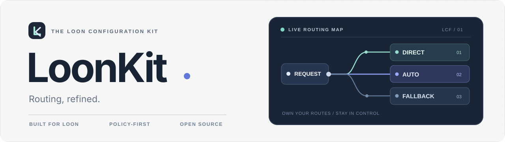

<p align="center">
  
</p>

<p align="center">
  <strong>让每一条连接，都有清晰的去向。</strong><br />
  精细分流 · 自由选路 · 广告管理 · 网络诊断
</p>

<p align="center">
  <a href="./docs/CHANGELOG.md"></a>
  <a href="https://github.com/YohakuSama/loonkit/actions/workflows/ci.yml"></a>
  <a href="./LICENSE"></a>
</p>

<p align="center">
  <a href="https://www.nsloon.com/openloon/import?sub=https%3A%2F%2Fraw.githubusercontent.com%2FYohakuSama%2Floonkit%2Fmain%2FLoonKit.lcf"></a>
  &nbsp;
  <a href="https://raw.githubusercontent.com/YohakuSama/loonkit/main/LoonKit.lcf"></a>
</p>

<p align="center">
  <sub>请在已安装 Loon 的 iPhone / iPad 上使用 Safari 打开。无法唤起？<a href="#手动导入">查看手动导入</a>。</sub>
</p>

<p align="center">
  <a href="#首次导入">首次导入</a>　·　<a href="#日常更新">日常更新</a>　·　<a href="#设置位置速览">设置位置</a>　·　<a href="#推荐设置">推荐设置</a>　·　<a href="#功能概览">功能概览</a>　·　<a href="#文档与支持">文档</a>
</p>

---

当前版本：**v7.0.9**。

LoonKit 是面向 [Loon](https://nsloon.app/) 的完整分流配置。它将国内服务、AI、开发工具、流媒体与社交平台的规则分开管理，并集成网络检测插件。**项目不提供代理节点或订阅**，你可以使用已有节点并决定每项服务如何选路。

## 开始之前

| 你需要 | 当前配置提供 |
| :--- | :--- |
| 已安装的 Loon、可用网络、自己的节点或节点订阅 | **39** 个策略组、**43** 份远程规则、网络诊断插件及图标 |
| 建议先备份个人配置、节点与订阅信息 | 正式配置入口：[`LoonKit.lcf`](https://raw.githubusercontent.com/YohakuSama/loonkit/main/LoonKit.lcf) |

> [!IMPORTANT]
> **第一次导入选「全覆盖更新」，后续常规更新关闭「全覆盖更新」。** 请先备份原配置：主文件的 `[Proxy]` 与 `[Remote Proxy]` 为空，全覆盖可能替换原有节点、订阅和本地设置。建议先完成首次全覆盖导入，再添加个人节点订阅。

## 首次导入

**01 / 下载并全覆盖**

1. 点击顶部 **「一键导入 LoonKit」**，按 Loon 弹出的导入提示操作；也可[手动导入](#手动导入)。
2. **首次部署**时，在导入 / 更新选项中选择或开启 **「全覆盖更新」**，使主配置的策略组、规则与插件按仓库基线载入。
3. 导入完成后，确认当前启用的是 `LoonKit.lcf`，再在 Loon 的节点模块添加自己的节点或订阅，刷新外部资源。

**02 / 关闭 DNS 查询回落（隐私优先）**

在 Loon App 依次打开：**设置 → DNS → DNS 服务器 → 查询回落 → 关闭**。

LoonKit 同时配置了 AliDNS 的 DoH 和普通 DNS。Loon 默认在加密 DNS 失败时尝试普通 DNS；关闭「查询回落」可以避免**这一回落路径**使用明文 DNS，但 DoH 不可达时可能出现域名解析失败。请按网络环境选择，并在 Wi-Fi 与蜂窝网络分别验证。此选项需要**在 App 内手动设置**，导入 `.lcf` 并不能代替操作。详见 [DNS 与隐私](./docs/DNS_PRIVACY.md) 和 [Loon 官方 DNS 说明](https://nsloon.app/docs/DNS/)。

**03 / 选择线路**

进入 Loon 策略组，在 `Proxy` 中选择可用线路；可按需调整 `Auto`、`Fallback` 的候选节点，再为 ChatGPT、YouTube 等服务单独选路。具体参考 [节点筛选与故障切换](./docs/NODE_SELECTION.md)。

### 手动导入

<details>
<summary><strong>无法通过按钮打开 Loon？展开手动导入教程</strong></summary>

打开 Loon 的配置文件导入入口，选择「从 URL 下载」，粘贴以下正式版地址并导入（不同 Loon 版本的入口文案可能略有不同）：

```text
https://raw.githubusercontent.com/YohakuSama/loonkit/main/LoonKit.lcf
```

也可以使用上方「获取配置文件」按钮下载 `.lcf` 后通过本地文件导入。若在 GitHub 内置浏览器无法唤起 Loon，请尝试 Safari；备用自定义 Scheme：[使用 loon:// 导入](loon://import?sub=https%3A%2F%2Fraw.githubusercontent.com%2FYohakuSama%2Floonkit%2Fmain%2FLoonKit.lcf)。

</details>

## 日常更新

首次导入后，**不建议每次更新都重新全覆盖**。请按以下步骤为这份远程配置设置更新策略：

1. 打开 Loon **「配置 → 配置文件」** 模块。
2. **长按 `LoonKit.lcf`**，进入 **「更新策略」**。
3. 按需设置配置文件的**更新频率**，并将 **「全覆盖更新」关闭**，以减少常规更新对本地节点、订阅和个人调整的覆盖风险。
4. 保存后，以后从该配置文件条目执行更新；更新主配置后，再刷新**远程规则和插件**。需要时也可 [在 Loon 中更新全部订阅资源](https://www.nsloon.com/openloon/update?sub=all)。

**更新频率怎么选？** 稳定使用时可选择 App 提供的较低频率，想及时获取配置变更时再提高频率；无需为了远程规则每天重复全覆盖主配置。自动检查的实际时机受 App 运行状态影响，不应理解为 iOS 后台必定准点更新。

> [!CAUTION]
> 关闭「全覆盖更新」**不等于保证所有本地改动永不受影响**。如果发布说明提示有策略组或主配置结构调整，先备份当前配置与节点信息，再核对是否需要重新全覆盖。恢复默认配置也会影响个人设置。

[完整导入与更新说明](./docs/LOON_APP_SETTINGS.md) · [版本更新记录](./docs/CHANGELOG.md)

## 设置位置速览

<p align="center"></p>

<p align="center"><sub>配置入口示意图 · <a href="./docs/SETUP_GUIDE.md">查看完整图文设置指南</a> · 图中开关为针对 LoonKit 的建议，并非所有插件的统一要求</sub></p>

## 推荐设置

以下建议基于当前 `LoonKit.lcf`，而不是通用于所有 Loon 配置：

| 项目 | 推荐做法 | 说明 |
| :--- | :--- | :--- |
| **流量模式** | **规则分流** | 让各服务独立策略组正常生效，避免全局直连绕过分流规则。 |
| **DNS 查询回落** | **关闭（隐私优先）** | 路径：**设置 → DNS → DNS 服务器 → 查询回落**；加密 DNS 失效时可能解析失败。 |
| **节点 / 策略组** | 添加个人订阅，再设置 `Proxy` 与筛选器 | 初始 `Auto` / `Fallback` 覆盖全部节点，并非个性化优化。 |
| **全覆盖更新** | **仅首次部署开启；平时关闭** | 大版本升级前先备份，并阅读更新记录。 |
| **DNS 拦截** | 保留配置中的 `DNS` + `LOOPBACKIP` | 如需优化拦截行为，可了解 [TUN Only 与 DNS 拦截的关系](https://nsloon.app/docs/General/)；不要仅为此盲改全部网络设置。 |
| **MitM 证书** | 只在其他插件明确要求时设置 | LoonKit 的网络诊断插件**不依赖 MitM**；无需仅为诊断安装证书。 |
| **Wi-Fi 共享** | 保持默认关闭 | 配置值为 `allow-wifi-access = false`；确需共享时再开启。 |

**兼容性提醒：** 当前配置使用 `disable-stun = true`、`udp-fallback-mode = REJECT` 和双栈 IP 模式。遇到 WebRTC、语音通话、UDP 游戏或 IPv6 问题时，应先看请求记录与节点能力，再针对性排查，不建议为了单个 App 故障关闭整套保护。[详细设置](./docs/LOON_APP_SETTINGS.md)。

## 功能概览

| 模块 | 功能 |
| :--- | :--- |
| **Routing** / 精细分流 | 国内常用服务优先直连；AI、Google、GitHub、流媒体和社交应用分组管理。 |
| **Control** / 自由选路 | `Proxy`、`Auto`、`Fallback` 和服务专属策略组。 |
| **Filtering** / 广告管理 | `AdBlock` 可切换 `REJECT`、`DIRECT` 或 `Proxy`。 |
| **Diagnostics** / 网络辅助 | 检查代理出口 IP、网络 / DNS 连通性，以及部分流媒体与 AI 服务的接口状态。 |
| **Maintenance** / 资源维护 | 43 份锁定版本的远程规则、版本记录、校验说明和 CI 工作流。 |

### 策略组速览

| 分组 | 使用建议 |
| :--- | :--- |
| `Proxy` | 选择主要代理线路，也可切换到自动或备用策略。 |
| `Auto` | 测试候选节点延迟后自动选择；测速地址为 `http://www.bing.com`。 |
| `Fallback` | 按候选顺序选择**第一个可用节点**，并非第二快节点。 |
| `AdBlock` | 默认拦截；遇到误拦截时可临时放行并查看请求记录。 |
| `Final` | 处理未被其他规则匹配的连接。 |

`Apple`、`Microsoft`、`Bilibili`、`Line`、`Speedtest` 的服务策略组默认优先 `DIRECT`，可根据实际需要切换。*策略组选项不等于全部请求一定命中该组；最终路由需以规则优先级及实际请求记录为准。*

### 网络辅助的边界

集成 [Network Diagnostics](./release/Network_Diagnostics.plugin) 插件，支持出口 IP 信息、连通性、DNS 以及 DAZN、Discovery+、Paramount+、Disney+、Netflix、ChatGPT、YouTube Premium 的访问检查。**检测结果不代表订阅会员权益，也不能独立证明全设备不存在 DNS 泄漏。**

[网络辅助说明](./docs/NETWORK_DIAGNOSTICS.md) · [分流排查](./docs/ROUTE_DIAGNOSTICS.md)

## 文档与支持

| 从这里开始 | 深入了解 |
| :--- | :--- |
| [可视化设置指南](./docs/SETUP_GUIDE.md) | [DNS 与隐私验证](./docs/DNS_PRIVACY.md) |
| [首次导入、更新与推荐设置](./docs/LOON_APP_SETTINGS.md) | [Loon 官方使用手册](https://nsloon.app/docs/) |
| [节点池与自动切换](./docs/NODE_SELECTION.md) | [规则说明](./rules/README.md) |
| [网络诊断插件](./docs/NETWORK_DIAGNOSTICS.md) | [更新记录](./docs/CHANGELOG.md) |
| [分流排查](./docs/ROUTE_DIAGNOSTICS.md) | [v7.0.9 校验](./docs/RELEASE_CHECKSUM_v7.0.9.md) |
| [维护与发布](./docs/MAINTAINING.md) | [依赖清单](./docs/DEPENDENCIES.md) |

<details>
<summary><strong>常见问题：导入后无节点、无法更新、分流异常</strong></summary>

- **导入后没有节点**：这属于预期情况，`[Proxy]` 和 `[Remote Proxy]` 未内置节点；请自己添加订阅。
- **更新后个人节点不见了**：检查是否开启「全覆盖更新」及是否覆盖了个人配置；从事先备份恢复并重新设置日常更新策略。
- **无法加载远程规则或图标**：先确认可访问 GitHub 的 `raw.githubusercontent.com`，再尝试刷新外部资源。
- **某些 App 打不开**：在请求记录里确认命中的分流规则、策略组与所选节点；必要时查看 [排查指南](./docs/ROUTE_DIAGNOSTICS.md)。
- **加密 DNS 故障后所有网站无法解析**：检查 DoH 连通性；若优先保障可用性，可自行决定是否重新开启「查询回落」。

</details>

<details>
<summary><strong>参考资料与说明</strong></summary>

本文以仓库当前 `v7.0.9` 正式配置为准，并对照 [Loon 官方 URL Scheme](https://nsloon.app/docs/Scheme/)、[官方 DNS 文档](https://nsloon.app/docs/DNS/)、[官方通用参数](https://nsloon.app/docs/General/) 及 [Loon 使用指北](https://wiki.repcz.link/loon/profile/)。部分历史知识库资料较旧，涉及界面名称、设置入口时以 App 当前版本为准。

</details>

---

<p align="center">
  <sub>Made for Loon · Built for clarity</sub><br />
  <a href="https://github.com/YohakuSama/loonkit/issues">问题反馈</a> &nbsp;·&nbsp;
  <a href="./SECURITY.md">安全报告</a> &nbsp;·&nbsp;
  <a href="./docs/THIRD_PARTY_NOTICES.md">第三方许可</a> &nbsp;·&nbsp;
  <a href="./LICENSE">GPL-2.0-only</a>
</p>
