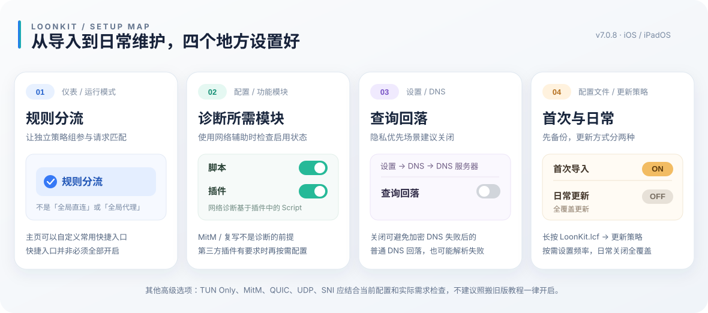

# LoonKit · 可视化设置指南

> 对应仓库正式版 **v7.0.8**。本文将常见 Loon 设置按用途整理，代替难以阅读的长截图。示意图不是 Loon App 的逐像素截图；不同版本、设备和系统语言的入口名称可能变化，实际界面优先。

<p align="center"></p>

## 01 · 仪表：运行模式与快捷方式

- **推荐使用「规则分流」**：让远程规则、服务策略组与兜底策略参与处理。全局直连不是等效选项，广告拦截规则也可能因此不能按预期处理。
- **仪表快捷卡片按自己习惯显示**：节点、规则、DNS 等入口主要用于查看与操作，不需要把所有卡片都强制打开。原参考图里关于快捷方式布局的内容属于个人偏好。
- 导入配置后先添加自己的节点订阅，在 `Proxy` 中选择节点，再检查 `Auto` 和 `Fallback`。

参考：[Loon 界面说明](https://wiki.repcz.link/loon/UI/) · [节点筛选](./NODE_SELECTION.md)。

## 02 · 配置：诊断功能所需开关

| 模块 | 对当前 LoonKit 的建议 | 原因 |
| --- | --- | --- |
| **插件** | 使用网络辅助时启用 | 主配置引用 `release/Network_Diagnostics.plugin`。 |
| **脚本** | 使用网络辅助时启用 | 诊断插件的三个功能在 `[Script]` 中实现，缺少脚本执行能力无法正常使用。 |
| **MitM** | **不需要仅为网络诊断开启** | 当前网络辅助使用 Generic Script，不要求 HTTPS 中间人证书。其他第三方插件如果明确要求 MitM，再按该插件说明操作。 |
| **复写** | 按需 | 网络诊断本身不依赖 Rewrite。 |
| **远程规则** | 确认启用并刷新 | 主配置依赖 43 份远程 `.lsr` 规则。 |

**不要仅凭旧截图，把「MitM over HTTP/2」「QUIC 回退保护」或其它功能全部设置成开启。** 是否需要取决于具体使用的插件、协议与 App 当前功能。

完成后可手动打开网络辅助插件的「节点信息」「网络检测」或「解锁检测」进行验证。DNS 检测功能需要 Loon Build 988+；插件元信息声明的最低版本为 Loon 3.5.1(983)。[网络辅助说明](./NETWORK_DIAGNOSTICS.md)。

## 03 · 设置 → DNS → DNS 服务器

**隐私优先建议：设置 → DNS → DNS 服务器 → 查询回落 → 关闭。**

这是 **App 内的开关**，并不能仅靠导入配置文件保证设置完成。Loon 官方文档说明：加密 DNS 失败后默认可回落到普通 DNS，关闭后可避免**此回落路径**发送普通 DNS 查询，但加密 DNS 不可用时会有解析失败的风险。

当前配置为：

```ini
dns-server = 223.5.5.5,223.6.6.6
doh-server = https://dns.alidns.com/dns-query
hijack-dns = *:53
```

- **查询回落**与**域名拒绝**是两种不同功能。前者影响 DoH 失败后是否尝试普通 DNS；后者处理命中 `REJECT` 规则的域名。
- LoonKit 的域名拒绝配置已采用 `domain-reject-mode = DNS` 与 `dns-reject-mode = LOOPBACKIP`。不需要为了复制截图而额外修改这两项。
- **TUN Only** 可以让部分 DNS 阶段拦截场景更完整，但不属于所有用户的强制要求。切换代理模式可能影响局域网、部分应用和调试路径，建议先测试再决定。
- `hijack-dns = *:53` 不能拦截所有应用内置 DoH/DoT。不能把关闭查询回落等同于「绝对没有 DNS 泄漏」。

参考：[Loon 官方 DNS 说明](https://nsloon.app/docs/DNS/) · [通用配置与 DNS 拦截参数](https://nsloon.app/docs/General/) · [DNS 核验清单](./DNS_PRIVACY.md)。

## 04 · 配置 → 配置文件：首次导入与日常更新

**第一次导入**

1. 先备份已有配置、节点和订阅信息。
2. 通过 [一键导入正式版](https://www.nsloon.com/openloon/import?sub=https%3A%2F%2Fraw.githubusercontent.com%2FYohakuSama%2Floonkit%2Fmain%2FLoonKit.lcf) 或 URL 导入 `LoonKit.lcf`。
3. 首次完整部署时选择 **「全覆盖更新」**。这可能覆盖原配置；当前主配置的 `[Proxy]` 和 `[Remote Proxy]` 本来就是空的，所以建议全覆盖后再添加个人节点订阅。

**日常维护**

1. 进入 **配置 → 配置文件**，长按 **`LoonKit.lcf`**。
2. 打开 **更新策略**，按需选择更新频率，并将 **「全覆盖更新」关闭**。
3. 更新后按需刷新远程规则和插件。更改主配置结构的版本升级前，请备份并阅读 [CHANGELOG](./CHANGELOG.md)。

> 关闭日常「全覆盖更新」能减少覆盖本地调整的风险，但不是保留所有个人编辑的保证。定时更新并不意味着 iOS 后台必定准点执行。

参考：[完整 App 设置和更新指南](./LOON_APP_SETTINGS.md) · [官方导入 URL Scheme](https://nsloon.app/docs/Scheme/)。

## 05 · 进阶设置：看需要，不要盲开

| 参考图涉及的设置 | LoonKit 当前状态与判断 |
| --- | --- |
| **SNI 辅助规则匹配** | 主配置已设 `sni-sniffing = true`，仅对适用的 TLS SNI 匹配起作用；不是通用明文嗅探。 |
| **UDP / STUN** | `disable-stun = true`、`udp-fallback-mode = REJECT`。在 WebRTC、视频通话或 UDP 游戏异常时核对节点能力，再定向处理。 |
| **IPv6** | `ip-mode = dual` 与 `ipv6-vif = auto`。保留双栈，不宜为处理单个故障直接全局关闭。 |
| **DNS 域名拒绝** | `DNS + LOOPBACKIP` 已由主配置声明；跟 DoH 查询回落无关。 |
| **MitM / QUIC 选项** | 不作为本项目安装前置条件。仅在特定插件或流量调试场景下操作，并了解证书与隐私风险。 |
| **局域网共享** | `allow-wifi-access = false`，默认关闭；仅需要局域网设备访问 Loon 时再调整。 |
| **连接测试** | `Proxy`、`Auto`、`Fallback` 测速使用 Bing；另有独立直连 204 检测，不能混为一谈。 |

**自查顺序：** 确认 Loon 已启用 → 确认规则分流 → 节点和订阅可用 → 策略组选路 → 规则 / 插件加载 → DNS 日志 / 请求记录 → 再调查高级设置。

### 资料适用性

本页参考了用户提供的旧版 Loon 设置流程图和历史知识库，但仅保留与当前 LoonKit 一致、能通过配置或官方资料确认的操作。**没有复制原作者头像、署名或旧版 App 截图，也没有沿用所有原始开关建议**。

官方资料：[Loon DNS](https://nsloon.app/docs/DNS/) · [Loon 通用配置](https://nsloon.app/docs/General/) · [URL Scheme](https://nsloon.app/docs/Scheme/)。

[返回 README](../README.md) · [配置文件设置](./LOON_APP_SETTINGS.md) · [DNS 检查](./DNS_PRIVACY.md)
